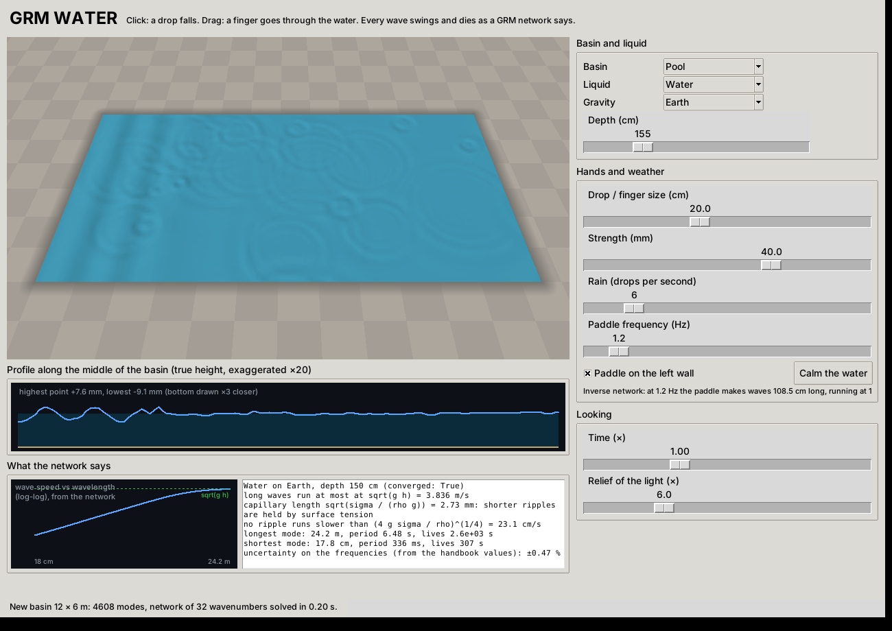
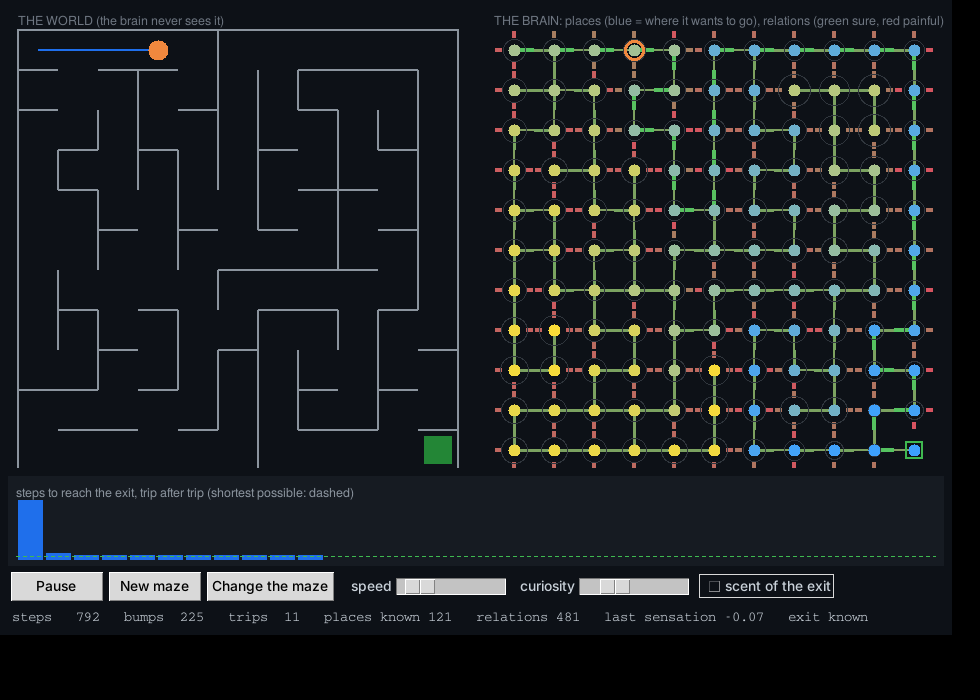
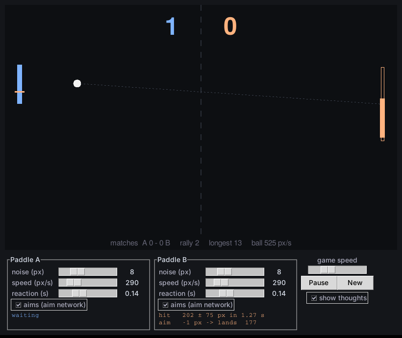

# GRM Core

> **Work in progress.** The engine, the tests and the guitar simulator work and are tested, but the project is young: APIs, values and hypotheses may still change.

**GRM Core** is the computing heart of the **Global Relational Model** (GRM), an attempt to describe physical systems through relations rather than objects. Each quantity is a node, each relation between quantities is an equation, and the whole network is solved at once, with the uncertainty of every input propagated to every result.

This repository contains:

| File | What it is |
|---|---|
| `grm.py` | The relational solver: one file, NumPy optional |
| `test_grm.py` | A hardcore test battery: 81 tests, plus a validation protocol for full models |
| `grm_model.py` | The full GRM physics network (147 quantities, 113 relations, 55 measurements), exported from the web model |
| `grm_sat.py` | Random 3-SAT written as a GRM network (one relation per clause), with a WalkSAT baseline |
| `grm_tsp.py` | The travelling salesman as a GRM network: an elastic ring pulled between cities and its own length |
| `grm_text.py` | Sentence categories without any training: a table of example sentences and their categories, and one small GRM network per new sentence |
| `grm_water.py` | **GRM Water**: a basin of liquid to play with (drops, finger, rain, paddle); every wave swings and dies as a GRM network says |
| `grm_brain.py` | **GRM Brain**: a brain that learns while it discovers a maze, with a memory of tensions; watch its network form |
| `grm_scales.py` | **GRM Scales**: from the forces to the classical world and back: atoms, rock, Jupiter, the Sun, asteroids and mountains as pairs in tension |
| `grm_voice.py` | **GRM Voice**: a voice made of relations. Lungs, vocal folds, airflow, vocal tract, velum, nose and lips are GRM networks; it says "Bonjour Anthony. Je suis le réseau." |
| `grm_pong.py` | **GRM Pong**: two paddles that play by themselves, each one deciding with two small GRM networks |
| `grm_guitar.py` | **GRM Guitar**: a guitar simulated as one object: strings, bridge, top, air, palm, fingers and the player's arm are all GRM networks |

The cosmology and particle-physics model this engine was built for is presented at [grm.anthony-charretier.fr](https://grm.anthony-charretier.fr), with its own repository: [innermost47/GRM](https://github.com/innermost47/GRM).


### Listen to the guitar model
Every sound below was rendered by `grm_guitar.py`, from the GRM networks only (no samples):

| Sound | What you hear |
|---|---|
| [strum_pick.wav](docs/audio/strum_pick.wav) | a G chord strummed down with a 0.71 mm pick |
| [strum_fingers.wav](docs/audio/strum_fingers.wav) | the same chord strummed with the fingers: softer release, rounder sound |
| [folk_loop_pick.wav](docs/audio/folk_loop_pick.wav) | C – Am – Em – G, folk strumming pattern played three times by the player network (no two strokes alike), with the fingers lifting, landing and rubbing between chords |
| [folk_loop_no_finger_noise.wav](docs/audio/folk_loop_no_finger_noise.wav) | the same loop without finger noise, to compare |
| [travis_fingers.wav](docs/audio/travis_fingers.wav) | C – Am, Travis picking (alternating bass) with the fingers |
| [palm_muted_rock.wav](docs/audio/palm_muted_rock.wav) | a power-chord riff at 120 BPM, muted by the palm network (skin on the strings near the bridge) |

---

## The idea

The GRM starts from one principle: a quantity only has meaning through its relations with other quantities. Pairs of opposites (hot and cold, full and empty, beginning and end) become numerical relations, and the relations are wired together into a network.

The engine does not explain *why* things are the way they are. It connects known elements, then submits the network to one test: **when a measurement is hidden, can the rest of the network recover it?**

The guitar simulator applies the same method to a concrete object. Every place where two things meet (string and fret, pick and string, finger and winding, air and wood) is written as a small network of relations, and the sound comes out of what those networks compute.

---

## The engine (`grm.py`)

### Nodes
- **positive quantities** (default), handled in log space: `x = log10(value)`. Values from 1e-44 to 1e122 coexist without loss.
- **signed quantities** (`"scale": "lin"`), handled as raw values: charges, curvature, equation of state.

```python
nodes = {
    "c": {"guess": 2.99792458e8, "fixed": True},   # a constant
    "m": {"guess": 1.0},                           # an unknown
    "w0": {"guess": -1.0, "scale": "lin"},         # a signed unknown
}
```

### Relations
| Type | Form | Example |
|---|---|---|
| log-linear (default) | `sum(coeff * log10(node)) = rhs` | `E = m c^2` -> `{"terms": {"E": 1, "m": -1, "c": -2}, "rhs": 0}` |
| `sum` | `sum(coeff * value^p) = K` | `Omega_b + Omega_c + Omega_L = 1` |
| `fn` | `f(values) = 0`, any equation | Koide, cosmological ages |

Each relation has a `sigma` (its tolerance, in dex for log-linear relations). A `rhs` may itself be a function of the current values.

### Measurements
Measurements are data with an uncertainty, not starting points:

```python
from grm import GlobalRelationalNetwork

net = GlobalRelationalNetwork(nodes, relations)
out = net.solve(measured_dict={"m": 2.0, "H0": (70.0, 0.01)})   # value, or (value, sigma in dex)
```

### Results
| Key | Meaning |
|---|---|
| `values` | best estimate of every node |
| `sigma_dex`, `uncertainty` | 1-sigma uncertainty (dex, and relative; absolute for signed nodes) |
| `undetermined` | nodes nothing determines: their value is only the starting point, not a prediction |
| `relation_pulls` | residual of every relation in sigma |
| `covariance`, `cost`, `reduced_chi2`, `converged`, `iterations` | the rest of the fit |

`leave_one_out(measured)` hides each measurement in turn and predicts it from the rest.

### Numerics
- weighted least squares solved by **QR factorisation**, not normal equations, so relations as tight as 1e-9 coexist with loose measurements;
- purely log-linear networks are solved exactly in a few steps;
- networks with sums or functions use **Levenberg-Marquardt**: Gauss-Newton with backtracking first, then adaptive damping; a warm start from the log-linear part of the network; a finite-difference Jacobian for functions;
- if a very tight `sum` or `fn` relation makes every step crawl and the solve does not converge, the core solves again by **continuation**: that relation loosened to sigma 1e-2, then tightened by a factor 100 per stage down to its own sigma, and keeps the better end point. It shares the iteration budget of the direct solve between its stages, can be turned off with `continuation=False`, and networks that converge directly are not touched;
- points outside the domain of a relation (the square root of a negative number, for example) are rejected cleanly;
- a very weak ridge keeps undetermined directions finite without biasing the determined ones;
- unknown node names, non-positive values in log space and invalid sigmas raise errors.

---

## The tests (`test_grm.py`)

```bash
pip install -r requirements.txt
python -m pytest -v test_grm.py
```

**1. Engine**: exact answers on small systems, the physical range from 1e-44 to 1e122, measurements as constraints, identifiability, state and inputs, robustness, the three relation types, and uncertainties checked against known propagation.

**2. Protocol**, run on Kepler's third law and on the Planck units, and on any full model:

```bash
GRM_SPEC=grm_model.py python -m pytest -v -s test_grm.py          # PowerShell: $env:GRM_SPEC = "grm_model.py"
```

- **leave-one-out**: each measurement is hidden, the starting points are drawn at random, and the network must recover it within 2 sigma. A value that changes with the starting point is reported as *not determined*, never as a success;
- **relation knock-out**: each relation is removed in turn. A relation matters if its removal moves a prediction by more than 0.1 sigma or widens its uncertainty by more than 5 %. Relations are sorted into definitions, untestable theory, redundant identities, and *idle claims*, which fail the test;
- **chance test**: every measurement is scrambled by up to a factor of 10. If the network recovers as many scrambled values as real ones, its successes prove nothing.

With part 3 below, the file holds 81 tests, all passing; 4 more run only on a full model.

**3. The water test.** A geometry test that looked like an emergent bond angle is kept as a lesson: the tests show that the angle is an input, not an emergence.

### Results on the full GRM model
- converges in 5 iterations, reduced chi2 = 0.35, no undetermined node;
- **42 of the 42 measurements** that another path can reach are recovered (13 have no other path);
- no claim and no established relation is idle (63 definitions, 9 untestable, 4 redundant identities in the black-hole chain);
- **42 recovered with the real values, 4.7 on average (at most 7) with scrambled values.**

The protocol checks the consistency of the network with today's measurements. It is not yet the proof by future measurements, which will come from the model's dated predictions.

---

## GRM Guitar (`grm_guitar.py`)

```bash
pip install numpy sounddevice        # sounddevice is optional: without it, WAV export still works
python grm_guitar.py
```

### The networks

**String** (one per string, solved for its fret)
```
wave speed    c^2 * mu / T = 1
fundamental   2 * L_eff * f1 / c = 1
fret          L_eff = L * 2^(-fret / 12)
steel core    d^2 = 4 * mu * k^2 / (pi * rho)          k: core share of a wound string
stiffness     B = pi^3 * E * d^4 / (64 * T * L_eff^2)   partials: f_n = n * f1 * sqrt(1 + B n^2)
```
- **Play**: length, mass and tension are the measurements; the network gives the note, its uncertainty in cents (about ±11 cents for L ±0.5 mm, mu ±1 %, T ±0.5 N) and the stiffness.
- **Tune**: the target pitch becomes the measurement, and the same network gives the tension.

**Attack**: the pick, or the finger, meets the string
```
string stiffness  k_s = T * L_eff / (x * (L_eff - x))    x: pluck point
release height    y0 = F / k_s                           loudness of each note
pick tip          k_c = E_p * b * t^3 / (4 * l^3)        a small bending beam (pick thickness t)
finger            k_c = flesh stiffness
release time      tau = pi * sqrt(m_c / k_c)             m_c: mass of string touched
brightness limit  f_c = 1 / (2 pi tau)                   the string slips off: highs softened
click energy      E_c = F^2 / (2 * k_c)                  snap of the pick (the pick's own vibration: not a force on the bridge)
```

**The player**: the arm meets the tempo (one network per sequence, nodes for every stroke)
```
intent            t_k = grid_k, A_k = A0 * accent_k, pluck point, pick depth   drawn with the player's imprecision
arm               t_k - t_(k-1) = grid_k - grid_(k-1)    the swing keeps its period; same continuity for A, p, d
hand speed        v_k = pi A_k / step                    half a pendulum swing per step -> time between strings
pluck force       F_k = F0 A_k / A0                      an upstroke is lighter
pick depth        o_j = d_k - (y_j - y_c)^2 / (2 R)      along the arc of the wrist: an upstroke misses the bass
```
The network finds what the arm actually does, a compromise between each intent and the continuity of the swing:
about 9 ms of timing spread (musicians: 10 to 20 ms), louder first beats, strums of 40 to 60 ms, a hand that
wanders along the strings. No two strokes are the same, and no two passes of a loop either.

**Palm**: the edge of the hand lies on a strip of the strings near the bridge
```
skin damping      r = R_skin * N                           pressure of the hand
contact width     w = w0 * (N / N0)^(1/3)                  Hertz contact: soft bodies pressed together
per metre         r' = r / w
inside the strip  kappa^2 = (mu w^2 - i w r') / T          complex wavenumber
mode n            y(fret) = 0 for a wave leaving the saddle (transfer matrices: free part, strip, free part)
                  -> one GRM network per mode: unknowns F_n and S_n (frequency, decay rate)
```
The palm is not a small perturbation: its resistance is larger than the string's own impedance `Z_s = sqrt(T mu)`
(0.7 kg/s for the low E, 0.17 for the high E). So each mode is solved exactly, followed from the free string while
the skin's resistance grows. What comes out, with no rule written for it: the long waves are partly reflected by the
strip (the string is cut a little shorter, the note goes a few cents sharp, and loses a share of its energy at each
round trip), the short waves enter the strip and die inside it, a light string is cut harder than a heavy one, and
moving the hand away from the bridge mutes more than pressing harder. That last point is what Ottaviani et al.
measured on players ("Towards a dynamic model of the palm mute guitar technique", ICMC-SMC 2014: "the distance of
the hand from the bridge is more important than the applied force"). The same paper found that the pressure drops
while the pick goes through the strings and comes back after: a struck note starts under half the palm's damping and
reaches it in 30 ms. Where the palm rests and how hard it presses change from stroke to stroke (player network).
While the palm rests, it mutes every string under it, including what the fingers do between chords and the strings
that answer in sympathy. Two sliders: "Palm pressure" and "Palm from bridge (mm)".

**Body and bridge**: the air in the box meets the wooden top, the top meets the strings
```
speed of sound    c_air^2 = gamma R T / M
Helmholtz         f_H = c_air / (2 pi) * sqrt(A / (V * l_neck)),  l_neck = t + 1.7 r
top plate         f_T = 10.21 / (2 pi a^2) * h * sqrt(E / (12 rho (1 - nu^2)))
coupling          the two oscillators push apart into the two lowest body resonances
radiation         f_rad = c_air / (2 pi a): the top radiates the bass poorly below it
plate rigidity    D = E h^3 / (12 (1 - nu^2))
plate impedance   Zp = 8 sqrt(D rho h)                   the top seen from the bridge, between its modes
bridge mass       m_b = share * rho_b V_b                Y_plate = 1 / (Zp + i w m_b): above Zp / (2 pi m_b)
                                                         the bridge lets less and less treble into the top
modal mass        M = beta * rho h pi a^2                the top seen from the bridge, at a mode
string impedance  Zs = sqrt(T mu)
bridge loss       sigma_n = (c / L) Zs Re Y(f_n)         each string gives its energy to the top
sound             p ~ i ka / (1 + i ka) * Y(f) F          the force moves the top, the moving top radiates
```

**The whole guitar.** A guitar is one object: every string pushes on the bridge, and the moving bridge moves every
string. The bridge velocity is `V = Y F` (all the strings together); mode n of a string answers with
`F_n = (2T/L)(-iw) Y F_others / (w_n^2 - w^2 + 2i (sigma_n + kappa_n) w)`, where `kappa_n = (c/L) Zs |Y|` is its
coupling to the bridge. So the open strings nobody plays, and a string the finger has just left, ring in sympathy;
a note sitting on a body resonance gives its energy away fast. A mode can share energy with the bridge but never
answer more than it receives (tested).

**Fingers on the frets** (chord changes)
```
finger position   x_f = L (1 - 2^(-fret / 12))
string height     h = h_nut + (h_12 - h_nut) x_f / (L / 2)
lift              the string jumps back from h: a soft, slow pluck of the open string (low, no click)
landing           the finger pushes the string onto its fret: a small knock on the stopped string
```
**Finger on the winding** (wound strings): measured on real strings by Pakarinen, Penttinen and Bank (JASA 2007), the
noise has moving harmonics at `k v / p` (one shock per turn of wire, level growing with v) and static harmonics: the
**longitudinal** modes of the string, while the fingertip damps the transverse ones.
```
winding wire      2 p = D - d_core,  D^2 = d_eq^2 / fill
slide             dx = |L_1 - L_2|,  v = dx / dt,  f = v / p
friction          P = mu_f * N * v
longitudinal      c_L^2 mu = E A_core,  f_L = c_L / (2 L)     only the steel core is stretched
```
The soft edge of the finger pad spreads each shock over `edge / v`, so most of the noise of a chord change is low.
When the finger slides from fret to fret it rides over the fret wires: each one is a knock of a share of the pressing
force lasting `crown / v`, a low woody thud. All of it reaches the ear only through the bridge and the body.
Check against the measurement: the paper reports the first longitudinal mode of an open 6th string near 1400 Hz;
the network gives 1400 Hz for a steel core of 36 % of the equivalent diameter (1750 Hz with the default 45 %).

**The room**: the sound meets the walls (optional, four sizes from a small room to a church, six wall materials)
```
volume, surface       V = L W H,  S = 2 (L W + L H + W H)
absorption            alpha_b by octave band (125 Hz to 4 kHz), walls and ceiling of one material, floor of wood
reverberation         RT_b = 0.161 V / (-S ln(1 - alpha_b))        Eyring
critical distance     r_c = 0.057 sqrt(V / RT)                     the room as loud as the guitar itself
mixing                reverberant energy = (r / r_c)^2 x direct    at the listener's distance r
Schroeder frequency   f_s = 2000 sqrt(RT / V)
```
The ear receives the direct sound, the first reflections (image sources, each wall a mirror, each bounce taking its
share), then a diffuse tail decaying band by band. How much room is heard is not a setting: it follows from the size,
the walls and the distance. Absorption coefficients: sengpielaudio's table.

### Synthesis
Modal synthesis of the force of each string on the bridge (in newtons), with the exact Fourier amplitudes of a
string plucked at a point. Each partial decays by its internal losses, the bridge loss and, under the palm, the skin.
The six strings and the finger noises are then coupled through the bridge, and the whole guitar radiates through its
body. The onset is the release itself, shaped only by the release time of the attack network.

### Playing
- play, strum down or up, arpeggio, palm mute, pick or fingers, steel stiffness, human feel, sympathetic strings;
- every setting, the room and the sequencer in one window, without tabs. **A setting moved while the guitar plays is
  heard at once**: the same playing (same player, same randomness) is rendered again in the background and takes
  the place of the sound at the same moment, with a 40 ms crossfade (a change of room or listener only recomputes
  the room). The notes are computed side by side on every core;
- a slow-motion view of the six strings (×100), with fingers on the frets and sliding between chords: **click a
  string to hear it alone**; a small oscilloscope below it;
- **sequencer**: 16 eighth-note steps, tempo, loop (two passes that differ). Each step holds a chord, notes written
  `string:fret` (e.g. `6:3 1:3`) or a rest, and a gesture: ↓ strum down, ↑ strum up, x palm-muted strum, · let ring.
  **Arpeggio mode** offers up and down, Travis (alternating bass), bass + chord, ballad and pinch patterns;
- WAV export.

### Hypotheses (all adjustable in the code)
Body dimensions and wood values are typical figures, not measurements of a given guitar. Other assumptions:
- share of the steel core in wound strings: 45 %, adjustable with a slider; metal fill of the winding: 80 %;
- skin-on-steel friction: 0.3; soft edge of the finger pad: 1 mm; share of the longitudinal force reaching the top: 0.3;
- pick plastic: 2.5 GPa, with a 5 mm wide, 4 mm free tip; fingertip pulp: about 2 N per mm;
- palm: 30 mm from the saddle (± 3 mm from stroke to stroke), 1 N per string (± 0.12 dex), 25 mm of skin on the
  strings, resistance 1 N s/m per newton (no measured value was found; a fingertip behaves as a damper above about
  150 Hz, Wiertlewski and Hayward 2012), half the damping released during the stroke, back in 30 ms;
- fret wire crown 2 mm, knock of 0.3 of the finger's pressing force;
- string height: 0.5 mm at the nut, 2.2 mm at the 12th fret; finger lift 3 ms, landing 1 ms;
- top: half of its mass moves in its first modes; its braces make it 4 times stiffer than bare spruce, seen from the bridge; rosewood bridge of 32 cm3, of which the saddle carries 20 % (set by ear);
- player: timing intent 15 ms (Repp and Su 2013: 10 to 20 ms for musicians), arm continuity 15 ms, swing 10 cm,
  pick 3 mm deep, wrist arc of 25 cm, accents on beats 1 and 3, upstroke 0.8 of the force.

---

## 3-SAT as a GRM network (`grm_sat.py`)

```bash
python grm_sat.py                                   # alpha = 3.11 (clauses per variable)
python grm_sat.py --alpha 4.2 --sizes 50 100 200 --trials 5 --restarts 3
python grm_sat.py --dimacs formula.cnf
```

Each variable is a positive node o_i whose truth value is v_i = o_i / (1 + o_i); each clause is a relation
(1 - l_1)(1 - l_2)(1 - l_3) = 0, zero as soon as one literal is true. The GRM engine solves the network, the result
is rounded, and every clause is checked. A classical WalkSAT runs on the same formulas as a baseline.

First results (random formulas, this machine):

| alpha | N | GRM: formulas fully satisfied | WalkSAT |
|---|---|---|---|
| 3.11 | 20 to 200 (3 each) | 12 / 12 | 12 / 12 |
| 3.11 | 500, 1000 (2 each) | 4 / 4 (6 s and 36 s per formula) | 4 / 4 (under 0.1 s) |
| 4.2 | 50 / 100 / 200 (5 each, 3 restarts) | 3 / 0 / 1 | 3 / 3 / 4 |

**GRM+** (`--compare`) adds two tensions between successive solves, using `set_sigma` from the core: a binarity
relation v (1 - v) = 0 per variable, loose at first then tightened round after round (continuous against discrete),
and a reweighting of every clause still false. On satisfiable formulas only (checked by MiniSat), alpha = 4.2,
WalkSAT limited to 20 000 flips:

| N | GRM | GRM+ | WalkSAT | GRM+ then WalkSAT |
|---|---|---|---|---|
| 50 (6 formulas) | 5 / 6 | 6 / 6 | 6 / 6 | 6 / 6 |
| 100 (8 formulas) | 4 / 8 | 7 / 8 | 8 / 8 | 8 / 8 |
| 200 (8 formulas) | 1 / 8 | 1 / 8 | 2 / 8 | 1 / 8 |

GRM+ clearly improves on plain GRM up to N = 100, but does not beat WalkSAT, and both struggle at N = 200 with this
flip budget. Work in progress.

At alpha = 3.11 random 3-SAT is in its easy region: below a density of 3.52, formulas are satisfiable with high
probability and a polynomial algorithm finds the solutions ([arXiv math/0310193](https://arxiv.org/abs/math/0310193)).
The hard region is near the conjectured threshold, about 4.2, where some formulas have no solution at all.

## Travelling salesman with the GRM only (`grm_tsp.py`)

```bash
python grm_tsp.py lin318.tsp --optimum 42029 --plot     # TSPLIB instance (EUC_2D), not included: download it
                                                        # from http://comopt.ifi.uni-heidelberg.de/software/TSPLIB95/
```

Two GRM methods, no algorithm borrowed from elsewhere:

- **Method 1, the circle by levels (pure GRM, no move).** Relations between groups first, then between cities.
  Cities linked by a chain of short gaps form a group. Each group centre gets a point on the unit circle, its place
  in the tour: attraction relations pull centres that are close on the map to close places, dispersion relations
  (sum of cos k theta and sin k theta = 0) make them fill the circle, and the core solves the network while the
  attraction is narrowed round after round. Inside a group, cities follow their angle around the group centre,
  starting from the city facing the previous group.
- **Method 2, tension refinement.** Every edge of the tour is a relation with residual sqrt(d), so the cost of the
  network is exactly the tour length. The most tense edges (length beyond the nearest-neighbour distance) are
  treated first: reversing a piece of tour, or moving one, two or three cities, is kept only if the total tension
  goes down. Then, round after round, a region around a tense edge (drawn in proportion to its tension) is released
  and rebuilt where the tension rises least. The network may *breathe*: a rebuild that ends a little higher can be
  kept, within an allowance that shrinks to zero over the rounds.


Results on lin318 (318 cities, optimum 42 029), same machine:

| Version | Method 1 | Method 2 | Time |
|---|---|---|---|
| first try: plain circle, strict refinement | 85 326 (+103 %) | 44 730 (+6.43 %) | 66 s + 23 s |
| **current: circle by levels, refinement with pieces and breathing** | **74 500 (+77 %)** | **43 136 (+2.63 %)** | **5 s + 46 s** |

For reference, a simulated annealing run with 2-opt moves (3 million moves, not part of this repository) reached
42 471 (+1.05 %) in 7 s on the same machine. Method 1 still gives a rough tour on a clustered map; method 2 does
most of the work. Work in progress.

## Sentence categories without training (`grm_text.py`)

```bash
python grm_text.py "le gardien a arrêté le penalty"
python grm_text.py --eval
```

A table, nothing more: on the left example sentences, on the right their category (5 categories, 25 French
sentences each, written for the demo). Nothing is fitted. For a new sentence, the GRM core solves a small network:

```
shares      one positive node s_c per category
balance     sum of s_c = 1                       what one category gains, the others lose
evidence    log s_c = log p(c | w)               for every known word w, read from the table,
                                                 sigma = 0.5 dex / sqrt(times w was seen)
```

The answer is the leading category when it leads the runner-up by more than 1 sigma (with their covariance),
otherwise `unsure: A or B`. A sentence with no word in the table gets `unknown`, not a guess. `explain` lists the
words that pulled the decision. The tight balance is handled by the core's continuation (see *Numerics*).

Results on 40 held-out sentences, written separately and never used to build the relations:

| Answer | Count |
|---|---|
| right | 32 |
| unsure, right one among the two | 5 |
| unsure, right one missing | 3 |
| confidently wrong | 0 |

Off-topic sentences: 4 of 6 give `unknown`. The two others share a word with the table by chance (`acte`, then `plante` and `besoin`)
and get an answer: the table is small, and a single shared word is enough. A larger table, or a minimum amount of
evidence, would be the next step.

## GRM Water (`grm_water.py`)
```bash
python grm_water.py              # the window
python grm_water.py --headless   # a drop in a bathtub, without a window
```


A basin of liquid seen from above. Click: a drop falls. Drag: a finger goes through the water and leaves a wake.
Rain, a paddle on the left wall, four basins (puddle, bathtub, pool, harbour), four liquids (water, sea water,
olive oil, mercury), three gravities (Earth, Mars, Moon) and the depth.

The surface is the sum of the standing waves of the basin (cosine modes, walls that reflect). How fast each one
swings and how fast it dies is the answer of one GRM network, solved for 32 wavenumbers covering the basin (the modes
in between read it by interpolation):
```
gravity          G = g k                     capillarity   C = (sigma / rho) k^3
restoring        S = G + C                   depth         th = tanh(k h)
dispersion       w^2 = S th
bulk viscosity   g_bulk = 2 nu k^2           walls, bottom g_edge = sqrt(nu w / 2) (k / sinh(2 k h) + 1/Lx + 1/Ly)
decay            gamma = g_bulk + g_edge
also             c0 = sqrt(g h), capillary length sqrt(sigma / (rho g)), slowest ripple (4 g sigma / rho)^(1/4)
```
The liquid's handbook values come with their uncertainties, so every frequency has one too (about 0.4 %).
A second network runs backwards: given the paddle's frequency, which wavelength must it make? (unknown: k).
What the network finds, without being told: water ripples never run slower than 23.1 cm/s, and do so near
1.7 cm; the capillary length of water is 2.73 mm; long waves in a 30 cm deep bathtub run at 1.72 m/s; a 2 Hz
paddle makes 39 cm waves. The tests check these numbers against the textbook values.

The picture: a fixed camera; each pixel sees the sky (with clouds, a texture to read the slopes) reflected by the
tilted surface (Fresnel, Schlick), and the bottom through the water, which absorbs red more than blue (Pope and
Fry 1997).

Limits: linear waves (small amplitude: no breaking, no splash, no drops thrown up), a flat bottom, perfectly
reflecting walls, a clean surface. The damping by the walls of a closed box (1/Lx + 1/Ly) extends the channel formula
of Robertson and Rousseaux (arXiv:1706.05255), a hypothesis; real water, with dust on its surface, calms down faster.

## GRM Brain (`grm_brain.py`)

```bash
python grm_brain.py                                   # the window: the world on the left, the brain on the right
python grm_brain.py --headless 10 --change-after 5    # without a window: steps per trip, the maze changed after trip 5
```



The brain and the maze are two separate things. The brain is never shown the maze: not its size, its walls, or
where the exit is. It only knows its own moves (from which it builds its own idea of where it is, as animals do),
feels a wall by bumping into it, feels the exit when it is there, and can smell it faintly (optional). Nothing is
learned before: everything is learned while it lives.

**Memory: a matrix of triplets (A, tension, B).** From place A, this move led to B, or into a wall, with the tension
it left, the sensation of the memory:
- a prediction that comes true lowers the tension (the relation becomes sure);
- a surprise (a wall where it went before) raises it; a wall has two sides, so the way back is shut too;
- a bump leaves a painful tension, remembered longer than a calm one;
- time brings every tension back towards neutral: a forgotten wall is tried again, a changed maze is learned again.

**Desire: a GRM network.** One node per known place, tied to its neighbours like springs: a sure relation is a stiff
spring, a doubtful one a soft spring. The exit, once found, is pinned at 0; every untried move leads to the unknown,
pinned at a height set by curiosity; every place leans weakly towards "far". The core finds the equilibrium after
every step: a landscape that only goes down towards what attracts, with no hollow to get stuck in. The brain follows
the slope, and avoids what hurt.

The window shows the world (with the brain's trail) and the brain itself: its places where it believes they are,
coloured by desire (blue: where it wants to go), its relations coloured by tension (green sure, red painful), its
doubt as a halo, and the steps of each trip against the shortest possible. "Change the maze" closes a passage on the
way it uses and opens another one elsewhere.

In tests on several mazes: the first trips explore (70 to 440 steps), then it takes the shortest way or close to it.
When the maze changes, one long trip follows (the surprise, the bumps, the exploring), then it settles again on a way
close to the new shortest one, sometimes the shortest itself.

Hypotheses: the learning, surprise, pain and forgetting rates, the stiffness of a sure relation, curiosity. The
brain knows its own moves exactly (no slipping), which makes "where am I" easy; noisy moves would be the next test.

## GRM Scales (`grm_scales.py`)

```bash
python grm_scales.py
```

Every scale of the classical world written as a pair in tension that gives a third thing, with established physics
(Carr & Rees 1979, Weisskopf 1975, Press & Lightman 1983, Lineweaver & Norman 2010):

| relation | pair in tension | what is born |
|---|---|---|
| a0 = hbar / (m_e c alpha) | electric pull x quantum agitation | the atom |
| rho = A m_p / (eta a0)^3 | size of atoms x mass of nuclei | the density of rock |
| R = a0 (alpha / alpha_G)^1/2 | gravity x electrons that refuse to be squeezed | the largest planet |
| M = m_p (alpha / alpha_G)^3/2 | gravity x atomic matter | its mass |
| M = m_p alpha_G^-3/2 | gravity x pressure of hot matter | a star |
| M_Ch = 3.1 (hbar c / G)^3/2 / (2 m_p)^2 | gravity x relativistic electrons | the heaviest white dwarf |
| R = 1.5 (sigma_y / G rho^2)^1/2 | gravity x strength of rock | the size from which a body is round |
| h = S / (rho g) | gravity x strength of the crust | the tallest mountain, on each planet |

Scaling laws carry a tolerance of 0.15 dex (they hold to a factor of a few). The same network is run both ways:

- **up**, from the constants of the small only: rock density within a factor 1.3, Jupiter's radius 1.2 and mass 1.2,
  a star within 1.9, the size from which asteroids are round 1.5, the heaviest white dwarf 1.44 solar masses. The
  mountains stay *not determined*: the strength of a planet's crust is not given by the small;
- **down, from the sky only** (Jupiter, the Sun, rock, asteroids, mountains; no atom): the fine-structure constant
  comes back within a factor 1.34, the proton mass 1.36, the electron mass 1.8;
- **cycle**: the large predicted by the small, used as data, gives back the small exactly (the network inverts
  without loss);
- **protocol**: each large-scale measurement hidden in turn is recovered within 2 sigma (10 of 10; the two atomic ones
  follow from the definitions and prove nothing), against 3.4 on average (at most 6) with scrambled values. The
  tallest mountains of Earth, Mars and Venus follow the 1/g law of one another.

Hypotheses: the mean mass number of rock (20), the spacing of its atoms (4 Bohr radii, loose), the yield strength of
rock under self-gravity (10 MPa, loose), prefactors of 1 in the scaling laws.

## GRM Voice (`grm_voice.py`)

```bash
python grm_voice.py                              # "Bonjour Anthony. Je suis le réseau." -> grm_voice.wav
python grm_voice.py "m e R s i ||" -o merci.wav  # any French phonemes (SAMPA), "|" pause, "||" end of sentence
python grm_voice.py --vowels                     # the eleven vowels, one after the other
```

Listen: [grm_voice_bonjour.wav](docs/audio/grm_voice_bonjour.wav), [grm_voice_vowels.wav](docs/audio/grm_voice_vowels.wav).

No recording, no learning, no speech library: every part of the voice is a network solved by the GRM core.

**Lungs, glottis and airflow** (one network per 5 ms)
```
pressure      dPg + dPc = Ps                         the lungs' pressure is shared by two orifices in series
glottis       U = (Ag + OQ/2 Avib) sqrt(2 dPg / rho)  Bernoulli
downstream    U = A_out sqrt(2 dPc / rho)            tongue or lip constriction, velum port, yielding walls
vibration     Avib = Amax k sqrt((dPg - P_th) / (P_ref - P_th))   no voicing below the threshold pressure
folds         f0 = 1 / (2 L_f) sqrt(stress / rho)    a string under tension
pressure      f0 += KP dPg                           pitch rises with the pressure across the folds
```
When the lips close for p or b, the pressure moves from the glottis to the lips and the voicing dies by itself;
when they open, the fast flow through the small opening is the burst.

**The vocal tract** is a tube of 0.5 cm sections whose areas come from the articulators (tongue place and
narrowing, tongue length, jaw, pharynx, lips, lip protrusion, velum). Each section is a lossless tube with the
viscous drag of its walls and the flow its yielding walls take; the lips and nostrils radiate. Its resonances are
the complex frequencies at which a closed glottis lets no flow through:
```
resonance     U_glottis(F + iB/2) = 0                two nodes (F, B), two relations (real and imaginary parts)
glottal loss  U_g + P_g / R_g,  R_g = 2 dPg / U      an open glottis widens the formants (from the airflow network)
nose          a side branch at the velum: poles of the whole, zeros where the closed mouth shorts it ([m], [n], nasal vowels)
hiss          p = K 1/2 rho v^2 (1 - (Re_c / Re)^2)  turbulence of the jet (Stevens), strongest at f = 0.2 v / d,
              through the resonances of the cavity in front of the constriction (s, ch, f, bursts)
```

**The vowels are found, not written.** For each vowel an inverse network has the articulators as unknowns and
measured formants as measurements (male averages, Wikipedia "Formant"); its relations are the tract's own
resonance relations. The network finds the mouth shape whose resonances match, within the limits of a human mouth:

| vowel | i | e | ɛ | a | ɑ | ɔ | o | u | y | ø | œ |
|---|---|---|---|---|---|---|---|---|---|---|---|
| F1 found / measured | 271 / 240 | 390 / 390 | 589 / 610 | 729 / 850 | 729 / 750 | 488 / 500 | 357 / 360 | 251 / 250 | 250 / 235 | 370 / 370 | 578 / 585 |
| F2 found / measured | 2221 / 2400 | 2174 / 2300 | 1798 / 1900 | 1493 / 1610 | 970 / 940 | 755 / 700 | 656 / 640 | 602 / 595 | 1964 / 2100 | 1895 / 1900 | 1690 / 1710 |

Where the match is not exact ([i], [a]), the measured formants ask for a mouth the bounds do not allow.

**Articulation in time.** Each articulator is a network over all the frames: the targets of the sounds are
measurements, the continuity of its motion (second difference ~ 0) is a relation. A sound that does not use an
articulator gives it no target, and the network moves it from its neighbours: coarticulation is what it finds.
The prosody is planned the same way (lung pressure, fold stress): a slow fall through each group, a rise at the end
of a group that goes on, a fall at the end of the sentence, and the French lengthening of the last syllable.

**Sound.** The glottal pulses (with the folds' small irregularities), the aspiration and the hiss are filtered,
frame by frame, by the transfer of the tract built from its GRM poles and zeros, then radiated from the lips.

**Hypotheses**: male tract of 17 cm and its typical areas; wall mass and resistance (Fant); folds 16 mm; phonation
threshold 300 Pa; turbulence constant K = 0.02 and the voice bar radiated by the walls (set without a measurement);
the bounds of a human mouth used by the inverse networks; the inertia of each articulator; the durations of the
sounds. Work in progress: how intelligible and how natural it is remains to be judged by ear.

## GRM Pong (`grm_pong.py`)

```bash
python grm_pong.py                 # tkinter window
python grm_pong.py --headless 3    # 3 matches without a window
```

The ball is the relation, the paddles are its two ends. No paddle has a rule of play: each one solves two small
networks with what it perceives, every reaction time.

```
intercept   x + vx * t = x_paddle            the ball comes to my line
            y_hit = fold(y + vy * t)         the walls fold its path
            x, y, vx, vy measured, with a noise that grows with the distance -> y_hit and its sigma
aim         y_land = fold(y_hit + vy_out(o) * T)     the hit offset o sets the return angle
            escape      high tension when y_land is within the other paddle's reach
            self reach  I must be able to get to y_hit - o in time
            edge        the ball may arrive 3 sigma away from y_hit: it must still meet the paddle
            safety      o measured at 0, sigma 0.4 paddle height
```

The ball speeds up at each hit, so sooner or later a paddle cannot reach it: a point. Matches are played to 11, then
a new one starts. The window shows what each paddle thinks: the predicted hit with its uncertainty, the dotted
relation between the ball and that point, and where it intends to send the ball. Noise, speed, reaction time and
aiming can be changed for each paddle.



With equal settings, a paddle that aims wins 57 % of the points against one that only intercepts (175 to 133 over
three runs of 1500 s). Aiming only paid off once the edge relation was added: without it, the aiming paddle hit too
close to the edge for its own uncertainty and lost more points than it won.

## Status and limits
- **Work in progress**: names, defaults and interfaces may change.
- Pure Python with NumPy: comfortable up to a few hundred nodes. The full knock-out protocol on the GRM model takes several minutes.
- The guitar is a physical model built from relations, not a sampled instrument. Several of its values are hypotheses, listed above.
- The GRM physics model is an attempt under test, presented with its successes, failures and limits on its own site.

## Credits
Concept, method and direction: **Anthony Charretier**. Code written in collaboration with Claude (Anthropic).

## License
[GNU Affero General Public License v3.0 or later](LICENSE) (AGPL-3.0-or-later).
