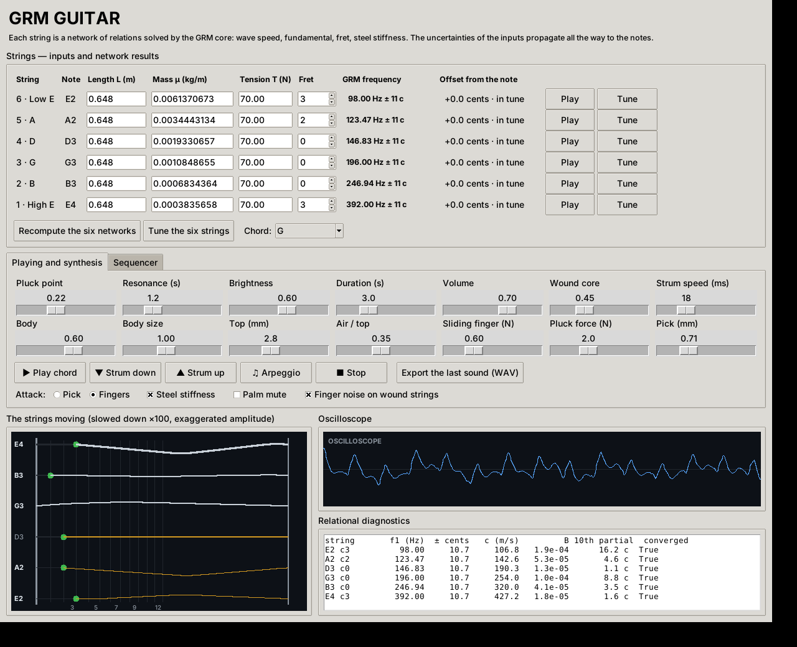
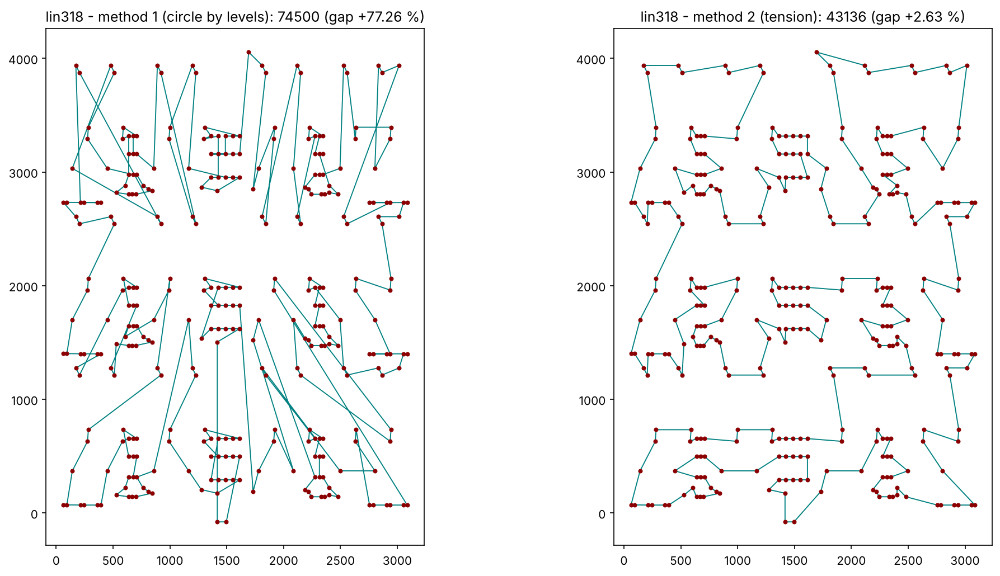

# GRM Core

> **Work in progress.** The engine, the tests and the guitar simulator work and are tested, but the project is young: APIs, values and hypotheses may still change.

**GRM Core** is the computing heart of the **Global Relational Model** (GRM), an attempt to describe physical systems through relations rather than objects. Each quantity is a node, each relation between quantities is an equation, and the whole network is solved at once, with the uncertainty of every input propagated to every result.

This repository contains:

| File | What it is |
|---|---|
| `grm.py` | The relational solver: one file, NumPy optional |
| `test_grm.py` | A hardcore test battery: 56 tests, plus a validation protocol for full models |
| `grm_model.py` | The full GRM physics network (147 quantities, 113 relations, 55 measurements), exported from the web model |
| `grm_sat.py` | Random 3-SAT written as a GRM network (one relation per clause), with a WalkSAT baseline |
| `grm_tsp.py` | The travelling salesman as a GRM network: an elastic ring pulled between cities and its own length |
| `grm_text.py` | Sentence categories without any training: a table of example sentences and their categories, and one small GRM network per new sentence |
| `grm_guitar.py` | **GRM Guitar**: a six-string guitar simulator whose strings, body, attack and finger noise are all GRM networks |

The cosmology and particle-physics model this engine was built for is presented at [grm.anthony-charretier.fr](https://grm.anthony-charretier.fr), with its own repository: [innermost47/GRM](https://github.com/innermost47/GRM).



### Listen to the guitar model
Every sound below was rendered by `grm_guitar.py`, from the GRM networks only (no samples):

| Sound | What you hear |
|---|---|
| [strum_pick.wav](docs/audio/strum_pick.wav) | a G chord strummed down with a 0.71 mm pick |
| [strum_fingers.wav](docs/audio/strum_fingers.wav) | the same chord strummed with the fingers: softer release, rounder sound |
| [folk_loop_pick.wav](docs/audio/folk_loop_pick.wav) | C – Am – Em – G, folk strumming pattern, with finger noise between chords |
| [folk_loop_no_finger_noise.wav](docs/audio/folk_loop_no_finger_noise.wav) | the same loop without finger noise, to compare |
| [travis_fingers.wav](docs/audio/travis_fingers.wav) | C – Am, Travis picking (alternating bass) with the fingers |
| [palm_muted_rock.wav](docs/audio/palm_muted_rock.wav) | a palm-muted power-chord riff at 120 BPM |

---

## The idea

The GRM starts from one principle: a quantity only has meaning through its relations with other quantities. Pairs of opposites (hot and cold, full and empty, beginning and end) become numerical relations, and the relations are wired together into a network.

The engine does not explain *why* things are the way they are. It connects known elements, then submits the network to one test: **when a measurement is hidden, can the rest of the network recover it?**

The guitar simulator applies the same method to a concrete object. Every place where two things meet (string and fret, pick and string, finger and winding, air and wood) is written as a small network of relations, and the sound comes out of what those networks compute.

---

## The engine (`grm.py`)

### Nodes
- **positive quantities** (default), handled in log space: `x = log10(value)`. Values from 1e-44 to 1e122 coexist without loss.
- **signed quantities** (`"scale": "lin"`), handled as raw values: charges, curvature, equation of state.

```python
nodes = {
    "c": {"guess": 2.99792458e8, "fixed": True},   # a constant
    "m": {"guess": 1.0},                           # an unknown
    "w0": {"guess": -1.0, "scale": "lin"},         # a signed unknown
}
```

### Relations
| Type | Form | Example |
|---|---|---|
| log-linear (default) | `sum(coeff * log10(node)) = rhs` | `E = m c^2` -> `{"terms": {"E": 1, "m": -1, "c": -2}, "rhs": 0}` |
| `sum` | `sum(coeff * value^p) = K` | `Omega_b + Omega_c + Omega_L = 1` |
| `fn` | `f(values) = 0`, any equation | Koide, cosmological ages |

Each relation has a `sigma` (its tolerance, in dex for log-linear relations). A `rhs` may itself be a function of the current values.

### Measurements
Measurements are data with an uncertainty, not starting points:

```python
from grm import GlobalRelationalNetwork

net = GlobalRelationalNetwork(nodes, relations)
out = net.solve(measured_dict={"m": 2.0, "H0": (70.0, 0.01)})   # value, or (value, sigma in dex)
```

### Results
| Key | Meaning |
|---|---|
| `values` | best estimate of every node |
| `sigma_dex`, `uncertainty` | 1-sigma uncertainty (dex, and relative; absolute for signed nodes) |
| `undetermined` | nodes nothing determines: their value is only the starting point, not a prediction |
| `relation_pulls` | residual of every relation in sigma |
| `covariance`, `cost`, `reduced_chi2`, `converged`, `iterations` | the rest of the fit |

`leave_one_out(measured)` hides each measurement in turn and predicts it from the rest.

### Numerics
- weighted least squares solved by **QR factorisation**, not normal equations, so relations as tight as 1e-9 coexist with loose measurements;
- purely log-linear networks are solved exactly in a few steps;
- networks with sums or functions use **Levenberg-Marquardt**: Gauss-Newton with backtracking first, then adaptive damping; a warm start from the log-linear part of the network; a finite-difference Jacobian for functions;
- points outside the domain of a relation (the square root of a negative number, for example) are rejected cleanly;
- a very weak ridge keeps undetermined directions finite without biasing the determined ones;
- unknown node names, non-positive values in log space and invalid sigmas raise errors.

---

## The tests (`test_grm.py`)

```bash
pip install -r requirements.txt
python -m pytest -v test_grm.py
```

**1. Engine**: exact answers on small systems, the physical range from 1e-44 to 1e122, measurements as constraints, identifiability, state and inputs, robustness, the three relation types, and uncertainties checked against known propagation.

**2. Protocol**, run on Kepler's third law and on the Planck units, and on any full model:

```bash
GRM_SPEC=grm_model.py python -m pytest -v -s test_grm.py          # PowerShell: $env:GRM_SPEC = "grm_model.py"
```

- **leave-one-out**: each measurement is hidden, the starting points are drawn at random, and the network must recover it within 2 sigma. A value that changes with the starting point is reported as *not determined*, never as a success;
- **relation knock-out**: each relation is removed in turn. A relation matters if its removal moves a prediction by more than 0.1 sigma or widens its uncertainty by more than 5 %. Relations are sorted into definitions, untestable theory, redundant identities, and *idle claims*, which fail the test;
- **chance test**: every measurement is scrambled by up to a factor of 10. If the network recovers as many scrambled values as real ones, its successes prove nothing.

With part 3 below, the file holds 56 tests, all passing; 4 more run only on a full model.

**3. The water test.** A geometry test that looked like an emergent bond angle is kept as a lesson: the tests show that the angle is an input, not an emergence.

### Results on the full GRM model
- converges in 5 iterations, reduced chi2 = 0.35, no undetermined node;
- **42 of the 42 measurements** that another path can reach are recovered (13 have no other path);
- no claim and no established relation is idle (63 definitions, 9 untestable, 4 redundant identities in the black-hole chain);
- **42 recovered with the real values, 4.7 on average (at most 7) with scrambled values.**

The protocol checks the consistency of the network with today's measurements. It is not yet the proof by future measurements, which will come from the model's dated predictions.

---

## GRM Guitar (`grm_guitar.py`)

```bash
pip install numpy sounddevice        # sounddevice is optional: without it, WAV export still works
python grm_guitar.py
```

### The networks

**String** (one per string, solved for its fret)
```
wave speed    c^2 * mu / T = 1
fundamental   2 * L_eff * f1 / c = 1
fret          L_eff = L * 2^(-fret / 12)
steel core    d^2 = 4 * mu * k^2 / (pi * rho)          k: core share of a wound string
stiffness     B = pi^3 * E * d^4 / (64 * T * L_eff^2)   partials: f_n = n * f1 * sqrt(1 + B n^2)
```
- **Play**: length, mass and tension are the measurements; the network gives the note, its uncertainty in cents (about ±11 cents for L ±0.5 mm, mu ±1 %, T ±0.5 N) and the stiffness.
- **Tune**: the target pitch becomes the measurement, and the same network gives the tension.

**Attack**: the pick, or the finger, meets the string
```
string stiffness  k_s = T * L_eff / (x * (L_eff - x))    x: pluck point
release height    y0 = F / k_s                           loudness of each note
pick tip          k_c = E_p * b * t^3 / (4 * l^3)        a small bending beam (pick thickness t)
finger            k_c = flesh stiffness
release time      tau = pi * sqrt(m_c / k_c)             m_c: mass of string touched
brightness limit  f_c = 1 / (2 pi tau)                   the string slips off: highs softened
click energy      E_c = F^2 / (2 * k_c)                  snap of the pick
```

**Body**: the air in the box meets the wooden top
```
speed of sound    c_air^2 = gamma R T / M
Helmholtz         f_H = c_air / (2 pi) * sqrt(A / (V * l_neck)),  l_neck = t + 1.7 r
top plate         f_T = 10.21 / (2 pi a^2) * h * sqrt(E / (12 rho (1 - nu^2)))
coupling          the two oscillators push apart into the two lowest body resonances
radiation         f_rad = c_air / (2 pi a): the top radiates the bass poorly below it
```

**Finger noise**: the finger meets the winding of a wound string
```
winding wire      2 p = D - d_core,  D^2 = d_eq^2 / fill
slide             dx = |L_1 - L_2|,  v = dx / dt
squeak            f = v / p          one shock per winding turn
friction          P = mu_f * N * v
```
Each shock rings the string itself, through its own high partials (from its string network): that is where the metallic sound comes from.

### Synthesis
Modal synthesis of the force of the string on the bridge, with the exact Fourier amplitudes of a string plucked at a point. Higher partials decay faster. The onset is the release itself, shaped only by the release time of the attack network.

### Playing
- play, strum down or up (adjustable strum speed), arpeggio, palm mute, pick or fingers, steel stiffness on or off;
- a slow-motion view of the six strings (×100), with fingers on the frets and sliding between chords, and an oscilloscope;
- **sequencer**: 16 eighth-note steps, tempo, seamless loop. Each step holds a chord, notes written `string:fret` (e.g. `6:3 1:3`) or a rest, and a gesture: ↓ strum down, ↑ strum up, x palm-muted strum, · let ring. **Arpeggio mode** offers up and down, Travis (alternating bass), bass + chord, ballad and pinch patterns;
- WAV export.

### Hypotheses (all adjustable in the code)
Body dimensions and wood values are typical figures, not measurements of a given guitar. Other assumptions:
- share of the steel core in wound strings: 45 %, adjustable with a slider;
- metal fill of the winding: 80 %;
- skin-on-steel friction: 0.3;
- pick plastic: 2.5 GPa, with a 5 mm wide, 4 mm free tip;
- fingertip pulp: about 2 N per mm.

---

## 3-SAT as a GRM network (`grm_sat.py`)

```bash
python grm_sat.py                                   # alpha = 3.11 (clauses per variable)
python grm_sat.py --alpha 4.2 --sizes 50 100 200 --trials 5 --restarts 3
python grm_sat.py --dimacs formula.cnf
```

Each variable is a positive node o_i whose truth value is v_i = o_i / (1 + o_i); each clause is a relation
(1 - l_1)(1 - l_2)(1 - l_3) = 0, zero as soon as one literal is true. The GRM engine solves the network, the result
is rounded, and every clause is checked. A classical WalkSAT runs on the same formulas as a baseline.

First results (random formulas, this machine):

| alpha | N | GRM: formulas fully satisfied | WalkSAT |
|---|---|---|---|
| 3.11 | 20 to 200 (3 each) | 12 / 12 | 12 / 12 |
| 3.11 | 500, 1000 (2 each) | 4 / 4 (6 s and 36 s per formula) | 4 / 4 (under 0.1 s) |
| 4.2 | 50 / 100 / 200 (5 each, 3 restarts) | 3 / 0 / 1 | 3 / 3 / 4 |

**GRM+** (`--compare`) adds two tensions between successive solves, using `set_sigma` from the core: a binarity
relation v (1 - v) = 0 per variable, loose at first then tightened round after round (continuous against discrete),
and a reweighting of every clause still false. On satisfiable formulas only (checked by MiniSat), alpha = 4.2,
WalkSAT limited to 20 000 flips:

| N | GRM | GRM+ | WalkSAT | GRM+ then WalkSAT |
|---|---|---|---|---|
| 50 (6 formulas) | 5 / 6 | 6 / 6 | 6 / 6 | 6 / 6 |
| 100 (8 formulas) | 4 / 8 | 7 / 8 | 8 / 8 | 8 / 8 |
| 200 (8 formulas) | 1 / 8 | 1 / 8 | 2 / 8 | 1 / 8 |

GRM+ clearly improves on plain GRM up to N = 100, but does not beat WalkSAT, and both struggle at N = 200 with this
flip budget. Work in progress.

At alpha = 3.11 random 3-SAT is in its easy region: below a density of 3.52, formulas are satisfiable with high
probability and a polynomial algorithm finds the solutions ([arXiv math/0310193](https://arxiv.org/abs/math/0310193)).
The hard region is near the conjectured threshold, about 4.2, where some formulas have no solution at all.

## Travelling salesman with the GRM only (`grm_tsp.py`)

```bash
python grm_tsp.py lin318.tsp --optimum 42029 --plot     # TSPLIB instance (EUC_2D), not included: download it
                                                        # from http://comopt.ifi.uni-heidelberg.de/software/TSPLIB95/
```

Two GRM methods, no algorithm borrowed from elsewhere:

- **Method 1, the circle by levels (pure GRM, no move).** Relations between groups first, then between cities.
  Cities linked by a chain of short gaps form a group. Each group centre gets a point on the unit circle, its place
  in the tour: attraction relations pull centres that are close on the map to close places, dispersion relations
  (sum of cos k theta and sin k theta = 0) make them fill the circle, and the core solves the network while the
  attraction is narrowed round after round. Inside a group, cities follow their angle around the group centre,
  starting from the city facing the previous group.
- **Method 2, tension refinement.** Every edge of the tour is a relation with residual sqrt(d), so the cost of the
  network is exactly the tour length. The most tense edges (length beyond the nearest-neighbour distance) are
  treated first: reversing a piece of tour, or moving one, two or three cities, is kept only if the total tension
  goes down. Then, round after round, a region around a tense edge (drawn in proportion to its tension) is released
  and rebuilt where the tension rises least. The network may *breathe*: a rebuild that ends a little higher can be
  kept, within an allowance that shrinks to zero over the rounds.



Results on lin318 (318 cities, optimum 42 029), same machine:

| Version | Method 1 | Method 2 | Time |
|---|---|---|---|
| first try: plain circle, strict refinement | 85 326 (+103 %) | 44 730 (+6.43 %) | 66 s + 23 s |
| **current: circle by levels, refinement with pieces and breathing** | **74 500 (+77 %)** | **43 136 (+2.63 %)** | **5 s + 46 s** |

For reference, a simulated annealing run with 2-opt moves (3 million moves, not part of this repository) reached
42 471 (+1.05 %) in 7 s on the same machine. Method 1 still gives a rough tour on a clustered map; method 2 does
most of the work. Work in progress.

## Sentence categories without training (`grm_text.py`)

```bash
python grm_text.py "le gardien a arrêté le penalty"
python grm_text.py --eval
```

A table, nothing more: on the left example sentences, on the right their category (5 categories, 25 French
sentences each, written for the demo). Nothing is fitted. For a new sentence, the GRM core solves a small network:

```
shares      one positive node s_c per category
balance     sum of s_c = 1                       what one category gains, the others lose
evidence    log s_c = log p(c | w)               for every known word w, read from the table,
                                                 sigma = 0.5 dex / sqrt(times w was seen)
```

The answer is the leading category when it leads the runner-up by more than 1 sigma (with their covariance),
otherwise `unsure: A or B`. A sentence with no word in the table gets `unknown`, not a guess. `explain` lists the
words that pulled the decision. The balance is solved by continuation (loose, then tight), as a tight sum alone
crawls.

Results on 40 held-out sentences, written separately and never used to build the relations:

| Answer | Count |
|---|---|
| right | 32 |
| unsure, right one among the two | 5 |
| unsure, right one missing | 3 |
| confidently wrong | 0 |

Off-topic sentences: 4 of 6 give `unknown`. The two others share a word with the table by chance (`acte`, then `plante` and `besoin`)
and get an answer: the table is small, and a single shared word is enough. A larger table, or a minimum amount of
evidence, would be the next step.

## Status and limits
- **Work in progress**: names, defaults and interfaces may change.
- Pure Python with NumPy: comfortable up to a few hundred nodes. The full knock-out protocol on the GRM model takes several minutes.
- The guitar is a physical model built from relations, not a sampled instrument. Several of its values are hypotheses, listed above.
- The GRM physics model is an attempt under test, presented with its successes, failures and limits on its own site.

## Credits
Concept, method and direction: **Anthony Charretier**. Code written in collaboration with Claude (Anthropic).

## License
[GNU Affero General Public License v3.0 or later](LICENSE) (AGPL-3.0-or-later).
