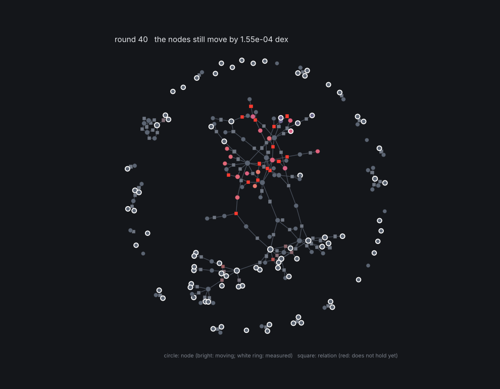

# grm talk

Talk to a GRM network from a terminal, write programs in it, watch it work, put it to sleep and wake it, and time it.
The language and the machine underneath are those of the GRM machine ([../vm](../vm)). The machine is relational: every node and every relation its own
small processor, talking only to its neighbours, working only when one of them has something new to say. The
network is the program, its memory and its calculator at once.

A proof of concept: the relational machine is simulated in Python, and both machines are priced with a cost model
(cycles), not measured on a chip.

```bash
pip install pygrm numpy matplotlib      # pygrm for `solve`, numpy for the classic machine, matplotlib for the graph
python talk/grm_talk.py                 # the prompt
python talk/grm_talk.py -c "load equation; relax; why S; bench"
python talk/grm_talk.py -c "use universe.grm; relax; ask S; ask g_moon; sleep u.json"
python -m pytest talk/test_talk.py
```



## The words

```
node c = 299792458 fixed                         a node (a positive quantity, solved in log10)
node x0 = 1 signed                               a signed quantity (a position, a speed): negative or zero allowed
relate entropy: S * hbar * G * H^2 = pi * c^5    a relation: products and powers, exact by default
relate stock: Estock * 2 * G * H = c^5 ± 0.01    ... or with its uncertainty (dex)
relate walk: x1 = x0 + vx1 * dt                  a sum (see below)
keep land: y1 >= 2 when x1 in 3 .. 8 and y0 in 1.999 .. inf     a contact
observe H = 2.18e-18 ± 1%                        a measurement (± in % or "± 0.004 dex"; a signed node: its unit)
forget H                                         the measurement of H is dropped

network platform(id, left, right, top)           a network that can be called: a network in the network
  keep land_{id}: y1 >= {top} when x1 in {left}-0.25 .. {right}+0.25
end
call platform(id=p1, left=5, right=7.5, top=2)   its relations join the network ({name} replaced)
use universe.grm                                 every statement of a file (its networks become callable)
```

**Sums are multiplications.** A signed quantity x is the exponent of a positive one, e^x: `x1 = x0 + v * dt` is
e^x1 = e^x0 · (e^v)^dt, a product with a power, the kind of relation the GRM solves in log. Each term of a sum holds
numbers, fixed nodes and one free node. When that free node is a positive quantity (`g` in
`vy1 = vy0 - g * dt`), a **converter** ties it to its signed twin (~g = g): the one relation between the world of
products (log g) and the world of exponents (e^g). It is the only relation that is not straight in log: it redraws
itself around the current value at each round.

**Contacts** decide by themselves: a contact pushes (holds its node at the bound) only while the conditions it
watches hold and what the node's other relations say of it is beyond the bound. The floor's push (`support`) is a
free node that only contacts decide.

`examples/equation.grm` writes S x Equant = Estock this way. `load store` reads the network of
`equation/data/grm_network_store.json` (its products and powers; function and sum relations are left out, the
language does not say them yet). `save FILE.grm` writes any network back in these words.

## The questions

| | |
|---|---|
| `solve` | the whole network at once (pygrm: one global factorization), with the uncertainties |
| `relax [rounds]` | the relational machine: rounds of messages, every node and relation at once |
| `ask NODE` | its value (± its uncertainty after `solve`; what was measured) |
| `why NODE` | what says what of it: each relation's own word on it, and how far each one is from holding |
| `what-if NODE = v ± s` | the answer if NODE were measured so: what moves, by how much (the network is left as it was) |
| `graph on` / `off` / `FILE.png` | the network drawn while it works (a window, or a picture without a screen) |
| `bench [op= cache= ram= hit= link= ghz=]` | the network on both machines |
| `bench sizes [n n n]` | random networks of growing size on both machines |
| `sleep FILE.json` | the network and the state of every processor (every value, every message) to a file |
| `wake FILE.json` | back as it was: it goes on from where it stopped, nothing is solved again |

On the graph, circles are nodes (bright while they move, a white ring when measured), squares are relations (red
while they do not hold yet). `ask` and `why` light the nodes and relations they speak of.

## The base: the universe (`universe.grm`)

The constants of SI (c, ħ, k_B, e, N_A exact; G, m_e, m_p, ε0, α measured, CODATA 2018), the cosmos today (H0,
Ω_Λ, Planck 2018) and the seven relations of the chain of `equation/` (l_P, H_end, ρ_Λ, E_stock, T_floor, E_quant,
S). S · E_quant = E_stock is not written: it comes out (1 to 2e-8; the relations are held to 1e-6). Three worlds
are called from a `planet` network (Earth, Moon, Mars): their surface gravity from G, their mass and their radius.

## The runtime (`../vm/runtime.py`)

The machine that runs programs. Every node and every relation is a processor; a message is two numbers (a precision
and a mean, Gaussian belief propagation). A processor that hears nothing new does nothing: a network whose
measurements do not change falls silent (`relax` on the universe: 8 rounds, then 0), and a change wakes only what it
reaches. A relation that sees its own answers swing back and forth (around loops of exact relations that say the
same thing twice) damps itself until it settles.

`sleep` writes the network and every message; `wake` reads them back and the network is quiet at once: waking takes
no round. In this Python simulation reading the JSON still takes the time of reading a file; a machine whose
processors keep their memory when switched off (non-volatile memory) would not even read it.

## The two machines of the benchmark (`machine.py`)

**Classic.** One core and a RAM. The weighted system is written in memory as a dense matrix, factorized
(Householder QR) and solved back, the way pygrm does it. Every operation and every memory access is counted.

**Relational.** One processor per node and per relation (or measurement), each with its own memory, linked to its
neighbours only. Each round, all at once: every node tells each of its relations what its other relations say of it;
every relation tells each of its nodes what it would be if the relation held. A message is two numbers (a precision
and a mean). This is Gaussian belief propagation on the network's factor graph. A relation of k nodes does about
12 k operations per round, whatever the size of the network.

**Cost model** (cycles, all adjustable): an operation 1; a memory access on the classic machine 4 when it hits the
cache, 100 when it goes to the RAM, 90 % hits; a message between two neighbours 10. A round of the relational
machine lasts as long as its slowest relation plus its slowest node plus two messages.

## What came out (this PC, default costs)

| network | free nodes | processors | rounds | classic dense QR | same messages on one core | relational | agrees with pygrm |
|---|---|---|---|---|---|---|---|
| S x Equant = Estock | 5 | 16 | 32 | 1.1e4 cycles | 7.6e4 | 3.3e3 | 2e-6 sigma |
| grm-core store | 166 | 515 | 134 | 1.9e8 | 9.2e6 | 2.2e4 | 0.035 sigma |
| random, 100 nodes | 100 | 352 | 83 | 5.1e7 | 4.3e6 | 1.1e4 | 5e-7 sigma |
| random, 1000 nodes | 1000 | 3532 | 83 | 4.9e10 | 4.3e7 | 1.5e4 | 7e-7 sigma |
| random, 10000 nodes | 10000 | 35332 | 82 | 4.9e13 (counted) | 4.3e8 | 1.6e4 | (pygrm not run) |

What this says, and what it does not:
- **The number of rounds hardly grows with the network** (about 80 from 100 to 10 000 random nodes): the
  information has to cross the network, and a random network is only a few links wide. So the relational
  machine's time stays almost flat while the classic dense solve grows as the cube of the size.
- **Against a dense solve the gap is huge, but a dense solve is the simplest classic program.** A sparse solver on
  the same CPU would cost far less. The fairer line is "same messages on one core": the same algorithm, run by one
  core with a RAM. There the relational machine wins by 23 x to 26 000 x, roughly because it has as many processors
  as the network has things, and no RAM to wait for.
- **It needs one processor per node and per relation** (35 332 for 10 000 nodes). The gain is bought with
  hardware.
- **Dearer links shrink the gain** (`bench link=1000`: the store network goes from 8 300 x to 650 x the dense
  solve).
- **On this PC, in Python, the relational machine is slower** (store network: 175 ms against 12 ms): it is
  simulated one processor after the other. The cycles are those of the two modelled machines.
- **Same answer?** On networks without loops, exact after as many rounds as the network is wide. On the random
  networks, within 1e-11 dex of the classic solve. On the store network, within 0.035 sigma of pygrm, not exact:
  where loops of exact relations say the same thing twice, belief propagation counts some information twice (one
  group of nodes, around MS). Its uncertainties are not reliable on loops: `solve` (pygrm) gives them.
- **First try, left out**: consensus ADMM (the textbook way to split a least-squares problem among processors). With
  weights from 1e-6 to 1e18 in one network, it was still 1e5 sigma away after 100 000 rounds.
- The settling rule waits until the moves stop shrinking; around loops of exact relations, the last rounds only
  wait out a jitter of about 1e-9 dex (the equation network has its answer after 6 rounds and stops after 32).

## Files

- `grm_talk.py`: the prompt, the questions, the benchmark (it uses `../vm/language.py` and `../vm/runtime.py`).
- `machine.py`: the benchmark's two machines (product networks), the cost model.
- `live.py`: the graph drawn while the relational machine works.
- `universe.grm`: the constants, the seven relations, the worlds.
- `examples/equation.grm`: S x Equant = Estock.
- `test_talk.py`: the words, both benchmark machines, the universe, sums, a ball falling on the Moon onto a floor,
  networks called.
