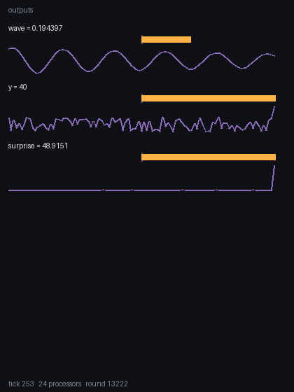

# The GRM machine

A virtual machine that is one GRM network, and nothing else. The network is the program, the memory and the
calculator at once. Every node and every relation is its own small processor, talking only to its neighbours, and
working only when one of them has something new to say. No game, no screen, no specialised areas: it is born with a
small base (a few measured points of the world) and becomes what it is told and what it learns. Its design follows
what is known of the brain where it can (see [Inspired by the brain](#inspired-by-the-brain)).

```bash
pip install pygrm                         # for the machine's units (optional otherwise)
python vm/grm_vm.py                       # the machine in the terminal
python vm/grm_vm.py --window              # the machine in a window: the outputs shown and heard
python vm/grm_vm.py --blank               # start blank: no memory, no base
python -m pytest vm/test_vm.py
```



## The language: GRML

The Global Relational Model Language. Full reference, tutorial and examples: [docs/GRML.md](../docs/GRML.md).

```
var x = 0                       a variable: a value the network holds until it is written again
set x = x + 1 [when ...]        at each tick, x is written (all the writes of a tick at once): loops
relate r: y = k * x + c [± 0.5] [when s in 0.5 .. 1.5]
                                a relation (products, powers, sums), holding only while its conditions hold: choices
learn k = 0                     a weight: what it learns stays (together with the weights it shares relations with)
fuse A B                        B was A under another name: one node, every relation of B now on A (the machine
                                also does it by itself)
input x [= 3]                   a node the outside measures (put, a file, the keyboard)
output y                        a node the outside reads (shown and heard)
input g positive [0 1 -2 0 0]   a positive node with its dimension [M L T Q K]: given and read in SI
node, observe, forget, keep, network ... end, call, use      as in grm talk
```

**A tick** is one beat of the machine's clock: Enter alone, `tick n`, the clock (`clock 10`, in the window) or a row
of a file. At each tick the network settles, then every `set` whose conditions hold writes its variable.

**Turing complete.** Variables written at each tick, conditions, and counters as large as the machine counts
exactly (integers up to 2^53, about 9e15): that is a Minsky machine (registers, "add one", "take one or jump if
zero"), and Minsky machines compute everything a computer computes (Minsky, 1967). `test_vm.py` writes any Minsky
program in the language (`minsky()`) and runs addition (7 + 5) and multiplication (6 × 7 = 42);
`programs/double.grm` is one by hand.

**Learning.** `load data.csv` (or `.json`: a list of records, `{name: [values]}`, `{name: value}`, or a grm-core store,
which joins the network) gives each row to the inputs, one tick a row. Weights that share a relation keep one
memory together: what they know, and how what they know of one is tied to the other (k and c of a line pull against
each other: a row that says k + c = 3 teaches their link, not each one alone). Before a new row is heard, that memory
takes in what the row before taught: each row counts once, and what the weights have learned is in the memory at the
next session. `programs/fit.grm` with `programs/measures.csv` (100 noisy points of y = 3x + 2) learns k = 2.9994 ±
0.016, c = 2.022 ± 0.050: the least squares on the same 100 points (2.99943, 2.02211). Four exact rows of y = 2x + 1
give 2 and 1.

**A base to hold on to** (`base.grm`, loaded at the first start, not with `--blank`): 30 points of the world (28 measured)
with their dimensions (the Planck scales, which are 1 inside; the atom; a human body; the Earth, the air, the water,
the la at 440 Hz; the Sun, the Hubble rate, the CMB) and three relations (the weight at the Earth's surface, the speed
of sound in a gas, Kepler's third law). Not knowledge of everything: points that new data can find. Nothing in it is fixed:
data can move all of it. A larger base loads the same way, with `load`.

**No node written twice.** The machine has its own routine against it, run after a file is loaded and at night: it
looks at what its inputs have been and fuses what is one thing under two names. Two inputs that agree row by row,
in level and spread (to 1 %): one node. An input that holds still at the value of a node known precisely (within 2
sigmas, and the node known to 1 % at least): that node (a column `g` at 9.8 becomes `earth_gravity`; a column
`price` at 70 does not become `human_mass`, known to 20 % only: such a coincidence says nothing). Every relation of
the fused node is moved to the one that stays, the old name keeps reaching it (in files, in statements, in the next
sessions), and each fusion is written down with its reason (`net.fusions`). `fuse A B` does the same by hand.

**Relations and nodes it makes by itself** (with pygrm 0.3.0, `pygrm.discover`), after every file and at night,
from the inputs it has seen moment after moment, only where the network does not tie them yet:
- power laws (y = K x^p, y = K x^p z^q, simple powers), straight lines, exponentials and logarithms (through a `ln`
  converter);
- sums built on products, when nothing simpler holds (E = 0.5 m v² + 9.81 m h): each product its own node, the sum
  tying them;
- what carries an input from one moment to the next: growth and decay (x(t) = a x(t-1) + c), oscillations
  (x(t) = a x(t-1) + b x(t-2) + c, with their period and damping). Its past becomes variables written at each tick:
  given 122 points of a damped wave and then nothing, it carries the wave on by itself;
- a node nobody mentioned: a hidden variable with its own law when the misses of a relation follow each other (a
  slow drift: the surprise falls from 26 sigma to 0.3), a constant when they stay on the same side;
- fusions, including inverses (a column of frequencies with a column of periods: one node, the frequency is the
  period to the power -1).

A blank machine given `programs/falling.csv` writes h = 4.906 t² by itself and uses it. The constants of what it
finds go on learning. Noise gives nothing. The user is told, not asked.

**Memory.** When it stops (`quit`, closing the window), the machine writes the network and every message to
`vm/memory.json`; when it starts, it reads them back and goes on from where it stopped, without solving anything
again. `sleep FILE` and `wake FILE` do the same with another file; `blank` starts over.

**Units.** Inside, the machine counts in its own units, where c, ħ, G and k_B are 1 (pygrm.units, "ticks"): the
fundamental constants are in how it counts, not in nodes. Every node with a dimension is given and read in SI (a
fall of 2 s at 9.81 m/s² reads 19.62 m; inside, g is 1.8e-51; a position of 4 m is 2.5e35 inside), positive nodes by
a shift of their log, signed ones by a scale.

## Inspired by the brain

What the machine takes from what is known of the brain, and where:
- **Magnitudes in log, uncertainties in proportion.** Perceived intensity follows roughly a log scale (Weber,
  Fechner), and Amazonian Mundurucu and young children place numbers on a logarithmic line (Dehaene et al. 2008).
  Here a positive quantity is held by its log, its uncertainty is relative, and a signed value said without its
  uncertainty is known to a thousandth of itself.
- **The inverse is the same node.** Division is a canonical computation of the brain (divisive normalization,
  Carandini & Heeger 2012). Here 1/x is -log x: the machine fuses a column of frequencies with a column of periods
  into one node.
- **Opposed channels.** Neurons cannot fire below zero: the brain carries a signed quantity on two opposed channels
  (ON and OFF cells of the retina, opponent colours, agonist and antagonist muscles). Here the body does it for a
  human: each output is seen as two channels around zero (ON to the right, OFF to the left) and heard as two voices
  (ON from 440 Hz, OFF from 220 Hz, higher as the value is larger, on a log scale). Inside, a processor can hold a
  negative number: a signed node is one value, not two (the pair would double the nodes for nothing a processor
  needs).
- **Rhythms.** Grid cells code a position by phases in periodic modules, and the hippocampus by the phase of firing
  in the theta rhythm (Moser et al. 2008). Here the machine finds the oscillations in what it sees (period, damping)
  and carries them on.
- **Synapses that know how sure they are.** Aitchison et al. (2021) propose that a synapse keeps not only a weight
  but its uncertainty, learns faster when it is unsure, and that the size of its signals varies with that
  uncertainty. Here every weight is a Gaussian (a value and a precision): an unsure weight moves a lot with a new
  row, a sure one hardly at all.
- **Weights that learn together.** Here weights that share a relation keep their links (an information matrix,
  `runtime.py`, `joint`): a row teaches what ties them, not only each one. (Without it, 4 exact rows gave k = 1.8
  instead of 2.)
- **Prediction errors.** In predictive coding (Rao & Ballard, 1999), the cortex carries what its predictions miss.
  Here, at each new input, every relation that hears the inputs says how far it is from holding, in its sigmas,
  before the weights have moved: the machine's **surprise**, shown and heard with the outputs (about 1 sigma on
  the rows of a line it has learned; 360 on a row that has nothing to do with it). An ignorant network is not
  surprised: its weights follow.
- **Sleep.** In the synaptic homeostasis hypothesis (Tononi & Cirelli), the synapses strengthened by the day are
  scaled down during sleep (about 80 % of the cortical synapses sampled in mice shrank by nearly 20 %), which makes
  room for new learning. Here, at the end of a session (`quit`), the precision of every learned weight is multiplied
  by 0.8 before it is written to memory; its value is kept.
- **Many paths, not echoes.** More relations make the network more exact only if they bring something new: a
  relation that says again what others say made the messages swing and blow up. A relation that sees its answers swing
  calms down.

Sources: [Dehaene et al. 2008, Log or linear? Distinct intuitions of the number scale](https://dash.harvard.edu/entities/publication/73120378-ac98-6bd4-e053-0100007fdf3b);
[Carandini & Heeger 2012, Normalization as a canonical neural computation](https://pmc.ncbi.nlm.nih.gov/articles/PMC3273486);
[Moser et al. 2008, Place cells, grid cells and the brain's spatial representation system](https://cenl.ucsd.edu/Jclub/Moser-Annreview+2008.pdf);
Sources: [Aitchison et al., Synaptic plasticity as Bayesian inference (arXiv 1410.1029; Nature Neuroscience 2021)](https://arxiv.org/abs/1410.1029);
[Rao & Ballard, predictive coding (review: arXiv 2112.10048)](https://arxiv.org/pdf/2112.10048);
[Tononi & Cirelli 2006, Sleep function and synaptic homeostasis](https://www.psychiatry.wisc.edu/courses/Nitschke/seminar/tononi%20&%20cirelli%202006%20sleep%20medicine%20reviews.pdf);
[NIMH 2017, sleep may trim neural connections](https://www.nimh.nih.gov/news/science-news/2017/sleep-may-trim-neural-connections-to-restore-learning-ability).

## The body (`body.py`)

The only part that is not the network: what a human uses to talk to it and to perceive what it gives out.
- In: the keyboard (statements, `put NAME = value`, Enter), files (`load`).
- Out, for the eyes: the window keeps a part for the outputs only: each output with its value, a bar and its last
  240 ticks. Nothing else is drawn.
- Out, for the ears (`sound on`): each output is a voice. Its pitch is where its value stands between the lowest
  and the highest it has had (two octaves from 220 Hz); its loudness is how much it has just moved. A network that
  holds still is silent. (winsound on Windows; sounddevice elsewhere if it is installed; otherwise silent.)

## Limits

- **Uncertainties.** The messages are Gaussian belief propagation: on networks with loops their uncertainties are not
  reliable (the values are). A relation that sees its own answers swing back and forth calms itself down (it was
  needed: a loop of exact relations saying the same thing twice made the messages blow up).
- **Learning is exact for weights that enter their relations straight** (y = k x + c, a sum of weighted terms). A
  relation where weights multiply each other or come with a power is drawn straight around where it is, at each row:
  close, not exact.
- **One wild row moves the weights**: the machine is surprised (it says so) but still learns from it.
- **A fusion is not undone yet.** Two things can share a value by chance; the rules above make it unlikely (only
  precise nodes, only values that hold still, only one candidate), not impossible.
- **Data from a file is taken as exact** (a column says its values, not their uncertainty): fused with a node of
  the base, it holds that node at its value.
- **What it finds by itself**: the forms above, between up to three inputs (a sum: up to three products). Every input
  is looked at; with many inputs, it will have to look first near what moves together.
- **It is Python**: the relational machine is simulated one processor after the other. A tick of a small program
  takes well under a millisecond here; a network of thousands of processors, more.

## Files

- `language.py`: the words.
- `runtime.py`: the relational machine (messages, conditions, converters, contacts, terms that multiply nodes,
  ticks, learning, sleep and wake).
- `grm_vm.py`: the machine (its memory, its units, data files) and its shell.
- `body.py`: the window, the outputs' panel, the voices.
- `base.grm`: the base it is born with.
- `programs/`: the examples of [docs/GRML.md](../docs/GRML.md) (`hello`, `fall`, `count`, `fibonacci`, `thermostat`,
  `circles`, `mean` + `numbers.csv`, `fit` + `measures.csv`, `double`), each one run by the tests.
- `test_vm.py`: Turing completeness (Minsky addition and multiplication), loops, choices, terms that multiply nodes,
  learning from CSV and JSON and remembering it, weights learning together (the least squares exactly), surprise,
  fusion by hand and by itself (and none with a vague node), the base, a night of sleep, sleep and wake (the same run as never
  sleeping), units, the voices, the shell.
